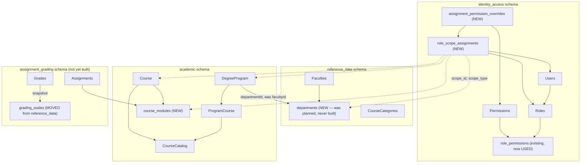
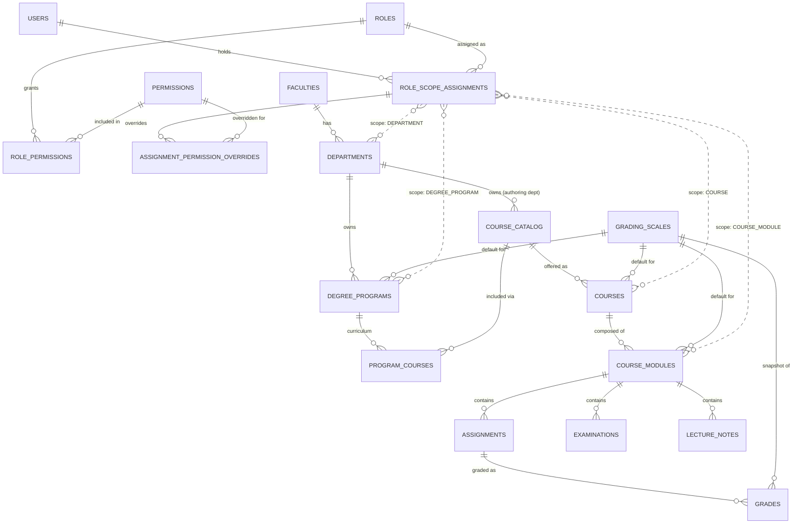

# UCMS — System Architecture and Database Architecture Report

**Status:** Analysis & proposed design only. No implementation has started from this report.
**Scope:** Advanced RBAC (departments, lecturers, course modules), Courses/Degree Programs UI redesign, grading-scale re-homing, admin/lecturer UI separation, academic-year filtering.
**Method:** Every claim about the *existing* system below was verified by reading the actual source, migrations, and `html-wireframes/index.html` — file paths and line numbers are given throughout. Claims about the *proposed* system are explicitly marked as design/recommendation, not fact.

---

## 1. Executive Summary

UCMS today is a **3-of-7-services** build-out: Identity & Access, Reference Data, and Academic Structure are implemented; Enrollment, Assignment & Grading, Notification, and Analytics & Reporting exist only as planned ER diagrams (`docs/architecture/tables-0{3,4,5,6}-*.mmd`). Authorization everywhere is **coarse and hardcoded**: a JWT carries a single flat `role` string (`ADMIN`/`LECTURER`/`STUDENT`), and every service's `SecurityConfig` gates endpoints with literal `hasRole("ADMIN")` expressions. A real, data-driven RBAC schema (`roles`/`permissions`/`role_permissions`) already exists in the database — it was designed for exactly this purpose — but **zero code reads or writes it**. The wireframe's "Roles & Permissions" screen is a fully client-side mock with no backend behind it at all.

This report finds that most of what the user is asking for is **not a system being bolted onto something unrelated** — it is the designed-but-never-wired RBAC schema, plus a small number of genuinely new concepts (course modules, department as a real entity distinct from faculty, department/program/course/module-scoped assignments, context-specific grading scales, and a shared academic-year selector) layered on top of it. The recommended design:

- Extends the existing `roles`/`permissions`/`role_permissions` tables (unchanged) with a new **scope-assignment** layer (`role_scope_assignments` + `assignment_permission_overrides`) that lets a user hold a role *at* a specific department, degree program, course, or course module, with optional per-assignment permission overrides.
- Introduces **`departments`** — already drawn in `docs/architecture/tables-07-reference-data.mmd` as a child of `faculties`, but never implemented. "Department of Mathematics" currently exists only as a fake row in the `faculties` table (code `DOM`) — this is a documented-but-unbuilt gap, not a new design.
- Introduces **`course_modules`** as a new child entity of `academic.courses` — genuinely new; neither the backend nor the wireframe has any concept of a module today.
- Moves **grading scales** out of Reference Data into Assignment & Grading (the service that actually consumes them), with program/course/module-level assignment and a snapshot-on-grade mechanism so historical grades survive scale edits.
- Replaces the fragmented, mostly-unwired per-page academic-year fields in the wireframe (verified: only the Admin Academic Calendar page's year selector is wired to anything, and it only affects that one page) with a single shared, backend-enforced academic-year context.

Nothing here requires discarding the 3 built services. Academic Structure's `DegreeProgram.facultyId` needs to become `departmentId`; Reference Data loses `GradingScale`; Identity & Access gains 3 new tables. Everything else is additive.

---

## 2. Existing System Architecture (verified)

### 2.1 Services and ports

| Service | Status | Port (local) | Schema |
|---|---|---|---|
| identity-access-service | **Built** | 8081 | `identity_access` |
| reference-data-service | **Built** | 8083 | `reference_data` |
| academic-structure-service | **Built** | 8084 | `academic` |
| gateway | **Built** | 8082 (dev) / 8090 (server) | — |
| enrollment-service | Planned only (`tables-03-enrollment.mmd`) | — | `enrollment` |
| assignment-grading-service | Planned only (`tables-04-assignment-grading.mmd`) | — | `assignment_grading` |
| notification-service | Planned only (`tables-05-notification.mmd`) | — | `notification` |
| analytics-reporting-service | Planned only (`tables-06-analytics-reporting.mmd`) | — | `analytics` |

One shared Postgres instance/database (`ucms`), one schema per service, each service connecting with its own schema-scoped role (`infra/init-schemas.sh`). Cross-service references are plain `uuid` columns with a `"ref <Service>, no FK"` comment — never a real foreign key across schemas. This is a deliberate, enforced-by-grants isolation boundary (`docs/architecture/DATA_GOVERNANCE.md`), and the proposed design below preserves it.

### 2.2 Current authentication & authorization (verified)

- `identity-access-service/src/main/java/com/ucms/identity/security/JwtService.java:30-40` — the JWT contains exactly `sub` (user id), `email`, `role` (a flat string), `iat`, `exp`. No permissions, no department, no scope of any kind.
- `identity-access-service/.../domain/Role.java` — `id`, `name`, `kind` (enum `ADMIN`/`LECTURER`/`STUDENT`, DB `CHECK` constrained). `name` is a free-text label distinct from `kind`.
- `identity-access-service/.../domain/Permission.java` — `module` (string), `action_key` (string). `identity-access-service/.../domain/RolePermission.java` — `(role_id, permission_id, granted)`. **These three tables are fully migrated (`V1__init_schema.sql`) but read/written by zero controllers or services** — verified by grep across `web/` and `service/`: no hits.
- `identity-access-service/.../repository/RoleRepository.java` — only method is `findByKindAndDeletedAtIsNull(RoleKind)`. `identity-access-service/.../web/dto/CreateUserRequest.java` — the `role` field is typed `RoleKind` (the enum), not a free `roleId`. **Conclusion: the backend can only ever create a user with role ADMIN, LECTURER, or STUDENT — there is no code path to create or assign a custom role today**, even though the `roles.name` column and the wireframe's mock data suggest otherwise.
- Every built service's `SecurityConfig` hardcodes `hasRole("ADMIN")` / `hasRole("LECTURER")` literally:
  - `identity-access-service/.../config/SecurityConfig.java:28-30` — `/users/**`, `/roles/**` → `hasRole("ADMIN")`.
  - `reference-data-service/.../config/SecurityConfig.java` — GET = authenticated, POST = `hasRole("ADMIN")`.
  - `academic-structure-service/.../config/SecurityConfig.java:29-34` — GET = authenticated, `POST /courses` = `hasRole("LECTURER")`, everything else = `hasRole("ADMIN")`.
- Frontend mirrors this exactly: `web/src/app/core/guards/auth.guard.ts` — `adminGuard`/`lecturerGuard` are literal `auth.currentUser()?.role === 'ADMIN'` string comparisons.
- **Wireframe's Roles & Permissions screen is 100% client-side mock** (`html-wireframes/index.html:1590-1626`, `913-959`): a `DB.roles` in-memory array with a `perms` matrix (`Module × [View,Create,Edit,Delete]` booleans), toggled instantly with no save step and no backend call (`App.togglePerm`). It also has an "Assign User" action that **overwrites the user's entire account role** (`user.role = role.name`) — not an additive scope assignment. `docs/FULL_SYSTEM_GAP_ANALYSIS.md` already flags this screen as the hardest item, explicitly stating it "changes the authorization architecture itself" and needs its own design pass — which is what this report is.

### 2.3 Current organizational hierarchy (verified)

- `reference-data-service` implements **`Faculty`** (`id, name, code, status`) only. It does **not** implement `Department`, despite `docs/architecture/tables-07-reference-data.mmd:18-31` already drawing `DEPARTMENTS { faculty_id FK, name, code, status }` with `FACULTIES ||--o{ DEPARTMENTS`. The seed data (`reference-data-service/.../V2__seed_data.sql:8-11`) works around the missing table by inserting `('Department of Mathematics', 'DOM', 'ACTIVE', ...)` as if it were a 5th faculty row. The wireframe does the same thing (`html-wireframes/index.html:409`, labelled tab `'Faculties & Departments'`, line 1630).
- `academic-structure-service/.../domain/DegreeProgram.java` has `facultyId` (plain uuid, "ref Reference Data, no FK") — it points at a faculty, never at a department, because department doesn't exist yet.
- **This means "Department" is not a new concept the user is asking for — it is a documented, originally-planned entity that was simply never built.** Completing it is a correction, not new scope.

### 2.4 Current academic structure (verified, built this session)

- `academic.academic_years` → `academic.semesters` (1:N).
- `academic.degree_programs` ↔ `academic.course_catalog` via `academic.program_courses` (curriculum, many-to-many — **one catalog subject can serve multiple degree programs**, e.g. "Discrete Math" required by both BSc-CS and BSc-SE).
- `academic.courses` — one *offering* of a catalog subject in a specific year+semester, with exactly **one** `lecturer_id` (plain uuid). No sub-structure below a course. No link to any grading scale. No link to a degree program directly (only indirectly, via the catalog subject's curriculum memberships) — this is actually correct and matches the wireframe's "standalone vs. program-linked course" distinction (`adminCourses()`, `DB.standaloneOfferings` vs `DB.lecturerCourses` joined through `DB.curriculum`) with no schema change needed.
- There is **no DB constraint preventing more than one `academic_years` row from having `status = 'ACTIVE'` simultaneously** — `V1__init_schema.sql` only `CHECK`s the enum value, not cardinality. This is a real latent bug relevant to Section 8.

### 2.5 Current UI role separation (verified)

- Angular routes already split by role via `adminGuard`/`lecturerGuard` (`web/src/app/app.routes.ts`): Academic Calendar, Degree Programs, Courses (oversight) are admin-only; My Courses / Create Course are lecturer-only. This pattern is correct and should be extended, not replaced.
- Wireframe's `NAV` object has exactly 3 top-level keys: `Admin`, `Lecturer`, `Student` (`html-wireframes/index.html:552-583`, confirmed in full). Custom account roles ("Program Coordinator", "Teaching Assistant") are mapped via `ROLE_GROUP` (`line 542-546`) onto the *same* Admin/Lecturer nav and dashboards — **the wireframe itself already treats these as dressed-up variants of Admin/Lecturer, not a 4th fundamental kind.** This is an important precedent for Section 5's design: it confirms the coarse `RoleKind` (`ADMIN`/`LECTURER`/`STUDENT`) can stay as-is for nav/dashboard selection; the new finer-grained roles layer on top of it, they don't replace it.
- Wireframe has **no** Examinations, Lecture Notes/Learning Materials, or course-Module concept anywhere (verified by exhaustive grep — zero hits for all three terms). It **does** already have a lecturer-facing "Students" page (`lecturer-students`, `html-wireframes/index.html:2006-2038`) that lists every student across all of a lecturer's courses — this needs the (unbuilt) Enrollment service to be real, but needs no RBAC change, since it's already naturally scoped by `Course.lecturer_id`.
- Academic-year selection in the wireframe is **not global**: `App.ui.selectedYear` (`line 628`) is read/written only by the Admin Academic Calendar page (`adminCalendar()`, `selectYear()`). Every other screen has its own, disconnected, frequently-hardcoded year field (`lecturerCourses()`'s year `<select>` has no `onchange` at all; `filterCourses()` reads a `#fltYear` element that is never actually rendered). This is a genuine gap matching Section 8 below.

### 2.6 Current grading scale (verified)

- `reference-data-service/.../domain/GradingScale.java` — `id, name, bands (string), status`. Verified by grep across the entire codebase: **no other table or entity references `grading_scale` in any form.** It is pure, unconsumed reference data. The *planned* Assignment & Grading schema (`tables-04-assignment-grading.mmd:34-46`) stores `GRADES.marks` as a raw `decimal` with no scale reference at all — so "grading scale actually used somewhere" was never part of the original design either. Section 9 below is genuinely new design, not a correction.

---

## 3. Current Functional Gaps and Limitations

| # | Gap | Evidence | Impact |
|---|---|---|---|
| G1 | No data-driven permission checking anywhere | Every `SecurityConfig` uses literal `hasRole(...)`; `role_permissions` table unread | Can't express "Dept Head of Computing can edit courses in Computing," only "any ADMIN can edit any course" |
| G2 | No scoping by department/program/course/module | No such table exists | Can't restrict a Dept Head or TA to their own department/course/module |
| G3 | Backend can't create custom roles | `CreateUserRequest.role: RoleKind` (enum-typed) | Wireframe's "Program Coordinator"/"Teaching Assistant" roles are unreachable from the real app |
| G4 | Department is modeled but not implemented | `tables-07-reference-data.mmd` has `DEPARTMENTS`; reference-data-service doesn't | "Department of Mathematics" is faked as a Faculty row |
| G5 | No course-module concept | Verified absent from both backend and wireframe | Can't assign partial responsibilities (notes-only vs. full module) within one course |
| G6 | Grading scale is disconnected reference data | Verified zero references anywhere | A scale can be edited/deleted with no record of what it affected; can't vary scale by program/course |
| G7 | No global academic-year context | Verified: year selector is page-local, several year fields are dead/unwired | Switching years on one page doesn't affect any other; easy to show mixed-year data by accident |
| G8 | No DB guarantee of exactly one active academic year | `academic_years.status` has no uniqueness constraint | Two years could both be `ACTIVE` simultaneously with no error |
| G9 | Lecturer/Admin course listings have no pagination or faceted filtering | `academic-structure-service` `GET /courses` returns an unpaginated `List<CourseResponse>` | Won't scale to a real university's course catalog |
| G10 | Reference Data `Faculty` is used as a stand-in for both Faculty and Department | Seed data + wireframe label "Faculties & Departments" | Flat list hides the real two-level hierarchy, blocks department-scoped RBAC |

---

## 4. Proposed System Architecture

High-level shape (unchanged services in **bold**, new tables marked `NEW`):



Design principles carried forward unchanged from the existing architecture (not revisited): schema-per-service, no cross-schema FKs (plain `uuid` + comment), optimistic locking via `version`, the standard audit block, JWT issued once by Identity & Access and independently validated by every service.

---

## 5. Advanced Roles and Permissions Architecture (proposed)

### 5.1 Two layers, not one

Today there is exactly one layer: a role's **baseline** permission grants (`role_permissions`). The proposal adds a second layer **on top**, without touching the first:

1. **Baseline (existing, unchanged):** `roles` → `role_permissions` → `permissions`. Defines what a role can do *by default*, wherever it's held. E.g. the "Lecturer" role's baseline might grant `Courses:View`, `Courses:Create`(own), `Grades:Edit`, but not `Users:*`.
2. **Scope assignment (new):** a user *holds* a role *at* a specific place in the org/academic hierarchy. The same "Lecturer" role held at Course A and at Course Module B are two different assignments with potentially different effective permissions.

This directly satisfies the requirement that "one lecturer may manage an entire course module, while another may only upload lecture notes" — both hold the same baseline role, but their assignment-level overrides differ.

### 5.2 New tables (identity_access schema)

```sql
-- A user holding a role at a specific point in the org/academic hierarchy.
-- scope_type/scope_id together identify *where* the role applies; NULL scope = global
-- (used for ADMIN, which is unscoped by nature).
CREATE TABLE role_scope_assignments (
    id              uuid PRIMARY KEY DEFAULT gen_random_uuid(),
    user_id         uuid NOT NULL REFERENCES users(id),
    role_id         uuid NOT NULL REFERENCES roles(id),
    scope_type      varchar(20) CHECK (scope_type IN
                        ('GLOBAL','DEPARTMENT','DEGREE_PROGRAM','COURSE','COURSE_MODULE')),
    scope_id        uuid,                 -- NULL when scope_type = 'GLOBAL'
                                           -- "ref Reference Data or Academic Structure, no FK"
    version         integer NOT NULL DEFAULT 0,
    created_at      timestamptz NOT NULL DEFAULT now(),
    created_by      uuid REFERENCES users(id),
    updated_at      timestamptz NOT NULL DEFAULT now(),
    updated_by      uuid REFERENCES users(id),
    deleted_at      timestamptz,          -- revoking an assignment is a soft delete
    deleted_by      uuid REFERENCES users(id),
    CHECK ((scope_type = 'GLOBAL') = (scope_id IS NULL))
);

-- Per-assignment permission overrides. If a (assignment, permission) row exists, it wins
-- over the role's baseline role_permissions grant for that permission, for that one
-- assignment only. Absence of a row means "use the role's baseline grant."
CREATE TABLE assignment_permission_overrides (
    assignment_id   uuid NOT NULL REFERENCES role_scope_assignments(id),
    permission_id   uuid NOT NULL REFERENCES permissions(id),
    granted         boolean NOT NULL,
    version         integer NOT NULL DEFAULT 0,
    created_at      timestamptz NOT NULL DEFAULT now(),
    created_by      uuid REFERENCES users(id),
    updated_at      timestamptz NOT NULL DEFAULT now(),
    updated_by      uuid REFERENCES users(id),
    PRIMARY KEY (assignment_id, permission_id)
);

CREATE INDEX idx_rsa_user ON role_scope_assignments(user_id) WHERE deleted_at IS NULL;
CREATE INDEX idx_rsa_scope ON role_scope_assignments(scope_type, scope_id) WHERE deleted_at IS NULL;
```

No existing table is altered. `roles`, `permissions`, `role_permissions` keep their current shape and finally get used.

### 5.3 Effective-permission resolution algorithm

For a request "can user U do action A (permission P) on resource R (known scope type + id, e.g. a specific course)":

1. Load U's `role_scope_assignments` (not soft-deleted) where `scope_type = 'GLOBAL'` **or** `(scope_type, scope_id)` matches R **or** matches an ancestor of R in the hierarchy `DEPARTMENT → DEGREE_PROGRAM → COURSE → COURSE_MODULE` (ancestor lookups resolved via Academic Structure's own tables — e.g. a course's department is resolved through its catalog subject's owning department, see §7.3).
2. For each matching assignment, resolve effective-grant-for-P = `assignment_permission_overrides` row if present, else the assignment's role's `role_permissions` baseline grant for P.
3. U is allowed if **any** matching assignment resolves to `granted = true`. (Most-specific-wins is intentionally *not* used for denial — an explicit grant at a broader scope should not be silently blocked by a narrower assignment that simply doesn't mention that permission. Overrides only ever narrow or widen *that one assignment's* own grant, never another assignment's.)
4. ADMIN keeps a `GLOBAL` assignment to a role whose baseline grants everything — no special-cased code path, it falls out of the same algorithm.

This keeps the algorithm simple (OR across matching assignments) and auditable (every grant traces to one row), at the cost of needing the full resolution to run per authorization check — see §12.3 for where this runs (JWT-embedded claims + locally cached permission catalog, not a synchronous call to Identity on every request).

### 5.4 Example: Department Head

```
roles:                 { id: r1, name: 'Department Head', kind: 'LECTURER' }
role_permissions:       r1 grants Courses:View/Create/Edit/Delete, DegreeProgram:View/Edit,
                        CourseModule:View/Create/Edit/Delete  (baseline, department-wide by convention)
role_scope_assignments: { user: dr-silva, role: r1, scope_type: DEPARTMENT, scope_id: computing-dept }
```
Dr. Silva now has Department Head's full baseline permission set over **everything under the Computing department** — every degree program, course, and module whose resolved department is Computing — with zero per-course rows needed. `kind = 'LECTURER'` is deliberate (see §5.6): Department Head is a specialization of the Lecturer account tier, not a 4th tier, matching the wireframe's own existing `ROLE_GROUP` precedent.

### 5.5 Example: two lecturers, same module, different rights

```
roles:                  { id: r2, name: 'Lecturer', kind: 'LECTURER' }  -- baseline: full module management
role_scope_assignments: { id: a1, user: dr-silva,  role: r2, scope_type: COURSE_MODULE, scope_id: m1 }
role_scope_assignments: { id: a2, user: ta-perera,  role: r2, scope_type: COURSE_MODULE, scope_id: m1 }
assignment_permission_overrides:
    a2 → CourseModule:Edit     = false
    a2 → Assignment:Create     = false
    a2 → Exam:Create           = false
    a2 → LectureNotes:Create   = true   -- (redundant if baseline already grants it; shown for clarity)
    a2 → Grades:Edit           = false
```
Both hold the same role at the same module; `ta-perera`'s overrides narrow them to notes-upload only.

### 5.6 Why `roles.kind` stays a 3-value enum

The wireframe already proves this works: `ROLE_GROUP` maps `'Program Coordinator' → 'Admin'` and `'Teaching Assistant' → 'Lecturer'` nav/dashboards (`html-wireframes/index.html:542-546`). `kind` answers one question only — *"which top-level nav/dashboard and which coarse JWT claim does this account get?"* — and three answers (ADMIN/LECTURER/STUDENT) are enough. "Department Head," "Program Coordinator," and "Teaching Assistant" are all `kind = LECTURER` rows in `roles` with their own `name` and their own `role_permissions`baseline, distinguished from a plain Lecturer purely by their permission grants and scope assignments — not by a new `kind` value. This avoids widening the `RoleKind` enum (and therefore the `CHECK` constraint, the JWT claim's value set, and every frontend `=== 'LECTURER'` guard) for what is fundamentally a permissions difference, not an authentication-tier difference.

### 5.7 Permission catalog additions

New `module` values needed in `permissions` (action_key stays `View/Create/Edit/Delete` per module, matching the existing wireframe matrix shape exactly, `html-wireframes/index.html:1609`):

| module | notes |
|---|---|
| `Departments` | new |
| `Course Modules` | new |
| `Lecture Notes` | new |
| `Assignments` | existing concept, formalize as its own module row (today folded into "Courses" in the mock) |
| `Examinations` | new |
| `Grading Scales` | new (was never a permission row; grading scale CRUD needs its own) |

Existing rows (`Degree Programs`, `Courses`, `Enrollments`, `Grades`, `Users`, `Reference Data`) are unchanged.

### 5.8 Permission matrix (illustrative baseline — admin-configurable, not hardcoded)

| Role | Dept. | Degree Programs | Courses | Course Modules | Assignments | Examinations | Lecture Notes | Grades | Grading Scales | Users |
|---|---|---|---|---|---|---|---|---|---|---|
| Administrator | — (global) | CRUD | CRUD | CRUD | CRUD | CRUD | CRUD | CRUD | CRUD | CRUD |
| Department Head | own dept. | CRUD | CRUD | CRUD | View | View | View | View | CRUD | — |
| Lecturer (full module) | assigned module | View | View (own) | Edit (own) | CRUD | CRUD | CRUD | CRUD (own) | Edit (own) | — |
| Lecturer (notes-only, via override) | assigned module | View | View (own) | View | — | — | CRUD | — | — | — |
| Teaching Assistant (grading-only, via override) | assigned module | — | View | View | View | — | — | Edit | — | — |
| Student | own enrollment | View (own) | View (own) | View (own) | View+Submit (own) | View+Submit (own) | View | View (own) | View | — |

---

## 6. Administrator and Lecturer UI Differences (proposed)

Three distinct layers must each enforce this, consistently:

1. **UI-level** — which pages/buttons render at all. Already partially done via `adminGuard`/`lecturerGuard`; extend with a `permissionGuard(module, action)` functional guard that checks the resolved effective permissions (see §12.3) rather than the raw account `role` string.
2. **Backend authorization** — every write (and scoped read) endpoint runs the §5.3 algorithm, not a hardcoded `hasRole`. A request that would be hidden in the UI must *also* be rejected server-side if attempted directly — this is non-negotiable per the user's requirement and is currently **not** true (e.g. nothing today stops a LECTURER-role JWT from calling `POST /academic-years` directly except the literal `hasRole("ADMIN")` check, which happens to work today only because there is no finer scope to bypass yet).
3. **Data-level** — list/detail endpoints filter by the caller's resolved scope assignments, not just by action permission. A Department Head's `GET /degree-programs` must return only programs under their department; this is a `WHERE department_id IN (<resolved scopes>)` added at the repository/query layer, independent of whether the `View` permission itself is granted.

| UI | Admin sees | Lecturer/Dept Head/TA sees |
|---|---|---|
| Degree Programs | all programs, all departments | only programs in their department (Dept Head) or none (plain Lecturer — not a program-level role) |
| Courses | all courses, paginated/faceted (§7) | only courses they're assigned to (Lecturer) or all courses in their department (Dept Head) |
| Course Modules | all, via drill-down from a course | only modules they're assigned to |
| Departments | full CRUD | Dept Head: view/edit own department's metadata only; others: view only |
| Students | all (via future Enrollment service) | only students enrolled in their own courses (already correctly scoped by `Course.lecturer_id` today, pending Enrollment) |
| Examinations / Assignments / Lecture Notes | view-all (oversight) | CRUD scoped to assigned modules only |
| Grading & Results | view-all | enter/edit scoped to assigned modules; Dept Head sees department-wide for oversight, edits only if also directly assigned |
| Lecture Notes / Learning Materials | view-all (oversight) | CRUD scoped to assigned modules |
| Academic Year Management | full CRUD | view only (read-only year context, see §8) |
| Roles and Permissions | full CRUD (this is itself a permission, `Users` + new `Roles` module) | no access by default |

---

## 7. Course and Degree Program Management Architecture (proposed)

### 7.1 Redesigned Courses UI — Administrator

Replace the current unpaginated `GET /courses` with a server-side paginated, faceted endpoint (mirroring the existing `Page<UserSummaryResponse>` shape already used by `identity-access-service`'s `GET /users` — i.e. this is extending an established pattern, not inventing a new one):

```
GET /courses?facultyId=&departmentId=&programId=&academicYearId=&status=&q=&page=0&size=20
```

Frontend: a 3-level drill-down (Faculty → Department → Degree Program) feeding a filtered, paginated course table, replacing the current flat "all courses in one table" admin-courses view.

### 7.2 Redesigned Courses UI — Lecturer

```
GET /courses?mine=true          -- today: WHERE lecturer_id = :me
GET /courses?mine=true          -- proposed: WHERE id IN (resolved COURSE/COURSE_MODULE scope assignments)
                                 --           OR department_id IN (resolved DEPARTMENT scope assignments)
```

The query parameter name and shape don't need to change; the *resolution* behind `mine=true` changes from "literally is the lecturer" to "resolves from my scope assignments," which transparently also covers Department Heads and Teaching Assistants without a new endpoint.

### 7.3 Department ownership of a course

A catalog subject (`course_catalog`) can serve multiple degree programs' curricula (verified, §2.4) — so department ownership cannot be attached to a `Course` offering or to a `DegreeProgram` alone without ambiguity when a Math-owned subject is used inside a CS program's curriculum. Recommendation: **anchor department ownership at `course_catalog`** (one subject is authored/owned by one department, even when cross-listed into other programs' curricula):

```sql
ALTER TABLE academic.course_catalog
    ADD COLUMN owning_department_id uuid NOT NULL; -- "ref Reference Data, no FK"
```

A course offering's resolved department = its catalog subject's `owning_department_id`. A degree program's resolved department = `academic.degree_programs.department_id` (renamed from `faculty_id`, see §10.2). These can legitimately differ (a CS program's curriculum can include a Math-owned course) — Dept Head permissions are evaluated against *whichever* resolved department is relevant to the action (editing the course definition → catalog's owning department; editing the program's curriculum membership → program's own department).

### 7.4 Course Modules (new)

```sql
CREATE TABLE academic.course_modules (
    id              uuid PRIMARY KEY DEFAULT gen_random_uuid(),
    course_id       uuid NOT NULL REFERENCES academic.courses(id),
    title           varchar(200) NOT NULL,
    sequence        int NOT NULL,
    grading_scale_id uuid,           -- "ref Assignment & Grading, no FK" — nullable, see §9
    version         integer NOT NULL DEFAULT 0,
    created_at      timestamptz NOT NULL DEFAULT now(),
    created_by      uuid,
    updated_at      timestamptz NOT NULL DEFAULT now(),
    updated_by      uuid,
    deleted_at      timestamptz,
    deleted_by      uuid,
    UNIQUE (course_id, sequence)
);
```

Anchored to `courses` (the offering), not `course_catalog` (the reusable subject definition), because lecture notes/assignments/exams/grades are inherently per-offering (this semester's Module 3 content differs from last year's) — this also means the (not-yet-built) Assignment & Grading service's `ASSIGNMENTS.course_id` reference (`tables-04-assignment-grading.mmd:7`) should become `ASSIGNMENTS.course_module_id` once modules exist, with `LECTURE_NOTES` and `EXAMINATIONS` (both new, not yet drawn anywhere) following the same pattern.

---

## 8. Academic Year Management and Filtering (proposed)

### 8.1 Database: enforce exactly one active year

```sql
CREATE UNIQUE INDEX idx_academic_years_one_active
    ON academic.academic_years ((true)) WHERE status = 'ACTIVE';
```

Service-level: `AcademicCalendarService.setActive(yearId)` must, in one transaction, flip the currently-ACTIVE year (if any) to `ARCHIVED` before/while setting the target year `ACTIVE` — the index above makes any attempt to leave two years `ACTIVE` fail loudly instead of silently succeeding (closes gap G8).

### 8.2 "No active year" and "multiple active years" handling

- If no year is `ACTIVE` (e.g. between terms, or right after seeding), year-scoped endpoints must accept an explicit `academicYearId` and must **not** silently default to "most recent by date" — the frontend's shared selector (below) falls back to the most recent `UPCOMING` year with a visible banner ("No active academic year — showing <year>"), never a silent guess.
- The unique index above makes "multiple active years" a constraint violation, not a runtime case the UI needs to handle.

### 8.3 Frontend: one shared context, not per-page fields

Add `AcademicYearContextService` (Angular, `providedIn: 'root'`) holding a single `selectedYearId` signal, initialized from `GET /academic-years`'s `ACTIVE` year. Every year-aware page (Courses, future Enrollment, Assignments, Grades, Course Modules — **not** Degree Programs' curriculum view, which is year-independent by design) reads this shared signal instead of keeping a local one, and a single selector lives in the app shell topbar (next to the existing user menu in `shell.component.html`) so changing it is a one-time, app-wide action — replacing the current fragmented pattern (§2.5) where only the Admin Calendar page's selector does anything.

Switching the shared year must not mix records: every list call made on a year change passes the new `selectedYearId` explicitly as a query param; nothing is cached keyed only by "current" without the id attached.

### 8.4 Historical years: read vs. write

- Any year with `status = 'ARCHIVED'` is **read-only** at the backend: write endpoints (`POST /courses`, `POST .../curriculum`, future grade entry) must reject with `409 Conflict` if the resolved academic year for the target resource is `ARCHIVED`, regardless of the caller's role — this is a backend rule, not a frontend hide, per the user's explicit requirement that filtering/restriction not be frontend-only.
- `UPCOMING` and `ACTIVE` years remain writable per the normal permission rules in §5.

### 8.5 Scope interaction

A Department Head's department-scoped assignment is **not** year-limited by itself — department membership doesn't change per year — but the *courses* and *modules* it resolves to are naturally year-scoped already (a `Course` row belongs to exactly one `academic_year_id`), so switching the shared year automatically changes which concrete courses/modules a Dept Head's permissions apply to, with no extra schema needed.

---

## 9. Grading Scale Management (proposed)

### 9.1 Move, don't duplicate

`reference_data.grading_scales` is dropped. A new `assignment_grading.grading_scales` is created when that service is built (it doesn't exist yet, so this is a clean move, not a live migration of production data beyond the 1 seeded demo row):

```sql
CREATE TABLE assignment_grading.grading_scales (
    id              uuid PRIMARY KEY DEFAULT gen_random_uuid(),
    name            varchar(200) NOT NULL,
    bands           jsonb NOT NULL,     -- e.g. [{"label":"A","min":70,"max":100}, ...]
    status          varchar(20) NOT NULL CHECK (status IN ('ACTIVE','INACTIVE')),
    version         integer NOT NULL DEFAULT 0,
    created_at      timestamptz NOT NULL DEFAULT now(),
    created_by      uuid,
    updated_at      timestamptz NOT NULL DEFAULT now(),
    updated_by      uuid,
    deleted_at      timestamptz,
    deleted_by      uuid
);
```

Rationale for moving it to Assignment & Grading rather than leaving it in Reference Data: Reference Data is for *shared, context-free* lookup values (faculties, categories) consumed identically everywhere. A grading scale is only ever consumed at the point grades are entered/displayed — co-locating it with `GRADES` means the service that enforces "this grade must fit this scale's bands" owns the scale definition directly, with no cross-service call needed on the grade-entry hot path.

### 9.2 Context-specific assignment, with override hierarchy

```sql
ALTER TABLE academic.degree_programs ADD COLUMN default_grading_scale_id uuid; -- nullable
ALTER TABLE academic.courses         ADD COLUMN grading_scale_id         uuid; -- nullable, overrides program default
ALTER TABLE academic.course_modules  ADD COLUMN grading_scale_id         uuid; -- nullable, overrides course
```

All three are "ref Assignment & Grading, no FK" (a deliberate, documented exception to the usual direction of cross-schema references — Academic Structure entities need to display/configure "which scale applies here" without a synchronous cross-service call on every program/course listing). Resolution order for "what scale applies to this module": `course_modules.grading_scale_id` → else `courses.grading_scale_id` → else `degree_programs.default_grading_scale_id` → else a single system-wide fallback scale seeded once.

### 9.3 Historical consistency

- **Snapshot on grade entry**: when a `GRADES` row is created, copy the resolved scale's `bands` verbatim into a `grading_scale_snapshot jsonb` column on that `GRADES` row, alongside a soft `grading_scale_id` reference. Displaying a past grade always uses the snapshot, never a live join — so editing or deleting a scale later cannot change how a historical grade is interpreted.
- **Immutable bands policy**: once a scale has been used in any `GRADES` row, its `bands` should not be edited in place — editing creates a new scale row (new `id`, e.g. `name = 'Standard Percentage v2'`) and the old row is left untouched (and can be set `INACTIVE` to hide it from new assignments without breaking existing `grading_scale_id` references and snapshots). This is a service-level policy enforced in `GradingScaleService`, not a DB constraint, documented here as a requirement for whoever builds Assignment & Grading.
- Only users with the `Grading Scales` permission (§5.7) — by default Administrators and Department Heads within their own department — may create/edit/retire scales; this is enforced by the standard §5.3 algorithm, scoped at `DEPARTMENT` for a Dept Head's own department's programs/courses/modules.

---

## 10. Proposed Database Architecture and ER Diagram

### 10.1 Full proposed ER diagram (new/changed entities only; unchanged entities shown for context)



### 10.2 Changed columns on existing tables

| Table | Change |
|---|---|
| `academic.degree_programs` | `faculty_id` → **renamed** `department_id` (still plain uuid, now "ref Reference Data `departments`, no FK"); add `default_grading_scale_id` (nullable) |
| `academic.course_catalog` | add `owning_department_id` (not null) |
| `academic.courses` | add `grading_scale_id` (nullable) |
| `academic.course_modules` | **new table** (§7.4), includes `grading_scale_id` |
| `reference_data.faculties` | unchanged |
| `reference_data.departments` | **new table**, implementing the already-planned `tables-07-reference-data.mmd` design |
| `reference_data.grading_scales` | **dropped** |
| `identity_access.role_scope_assignments` | **new table** (§5.2) |
| `identity_access.assignment_permission_overrides` | **new table** (§5.2) |
| `assignment_grading.grading_scales` | **new table**, when that service is built (§9.1) |

---

## 11. Entity Relationships, Foreign Keys, Constraints, and Indexes

- All new tables follow the existing audit-block standard (`version`, `created_at/by`, `updated_at/by`, `deleted_at/by`) per `docs/architecture/DATA_GOVERNANCE.md`, **except** `assignment_permission_overrides` and `role_permissions` (existing precedent), which — like the existing `role_permissions` — omit soft delete (an override is removed outright, not soft-deleted, matching the already-established `AuditableNoSoftDelete` pattern used for junction/log tables).
- `role_scope_assignments.deleted_at/deleted_by` **are** present (unlike the override table) — revoking a person's department-head assignment should be auditable and recoverable, matching how other primary (non-junction) entities are soft-deleted.
- Real FKs only within a schema: `role_scope_assignments.user_id/role_id` are real FKs (`identity_access` schema); `role_scope_assignments.scope_id` is a plain uuid with a `CHECK` only on `scope_type`'s enum value, never a FK (the target lives in a different schema/service).
- New indexes: `idx_rsa_user`, `idx_rsa_scope` (§5.2); `idx_academic_years_one_active` (§8.1); `idx_course_catalog_owning_department` on `course_catalog(owning_department_id)`; `idx_course_modules_course` on `course_modules(course_id) WHERE deleted_at IS NULL`.
- `UNIQUE (course_id, sequence)` on `course_modules` prevents two modules claiming the same position within a course.
- `CHECK ((scope_type = 'GLOBAL') = (scope_id IS NULL))` on `role_scope_assignments` prevents a half-specified scope.

---

## 12. Backend API and Authorization Changes

### 12.1 New endpoints (Identity & Access)

```
GET    /roles                                  -- list roles + their baseline permission grants
POST   /roles                                  -- create a custom role (name, kind, baseline grants)
PATCH  /roles/{id}/permissions                 -- toggle a baseline grant (role_permissions)
GET    /users/{id}/assignments                 -- list a user's role_scope_assignments
POST   /users/{id}/assignments                 -- create {roleId, scopeType, scopeId}
PATCH  /assignments/{id}/overrides             -- set/clear a permission override for one assignment
DELETE /assignments/{id}                       -- revoke (soft delete)
GET    /departments                            -- (proxied/owned by Reference Data, see below)
```

### 12.2 Changed endpoints

```
GET /courses?facultyId=&departmentId=&programId=&academicYearId=&status=&q=&page=&size=   (academic-structure-service)
GET /courses?mine=true   -- resolution changes from "lecturer_id = me" to scope-assignment resolution (§7.2)
POST /degree-programs    -- facultyId → departmentId
```

### 12.3 How authorization actually runs per-request (the hard part)

Given schema-per-service isolation, a request arriving at e.g. `academic-structure-service` cannot cheaply query `identity_access.role_scope_assignments` directly (different schema, different DB role, no cross-schema grant — by design). Three options, with a recommended phasing:

1. **Synchronous callback to Identity & Access on every request.** Simplest to reason about, but reintroduces a hard synchronous dependency between every service and Identity, which the existing architecture has deliberately avoided (JWT validation today is already local-only, specifically to avoid this). **Not recommended** as the steady-state design.
2. **Embed resolved scope assignments directly in the JWT**, recomputed at login (and on refresh): `assignments: [{roleId, scopeType, scopeId}]`. Each service still needs the role→permission baseline (and any overrides) to finish the resolution locally — fetched from a small, cacheable `GET /roles` (Identity & Access), refreshed periodically (e.g. every few minutes) in each service's memory, since permission *definitions* change rarely (admin-driven) while scope *assignments* change more often (a new TA assigned mid-semester). **Recommended for Phase 1** — no new infrastructure required, consistent with the existing "each service independently validates the JWT" pattern.
3. **Event-driven propagation via RabbitMQ** (already provisioned in `infra/docker-compose.infra.yml`, currently unused by any service): Identity & Access publishes `role.permission.changed` / `role.scope.assignment.changed` events; each service maintains a small local read-only replica of the permission catalog and relevant scope assignments, updated on event receipt. This removes the staleness window of option 2 entirely (a revoked assignment takes effect immediately, not at next login) at the cost of real implementation complexity (event schema, idempotent consumers, eventual-consistency edge cases). **Recommended as Phase 2**, once RabbitMQ is actually wired into any service for the first time — this report does not recommend blocking the RBAC rollout on building the event bus first.

Either way, the *shape* of the decision (§5.3's algorithm) is identical — only *where the data needed to run it lives* changes between phases.

### 12.4 Consistency requirement (explicit, per the user's ask)

Every authorization check must be re-run server-side regardless of what the UI already hid — this report does not recommend any endpoint that trusts a client-supplied role/permission claim beyond the signed JWT's own contents. A request bypassing the UI (direct `curl`/Postman with a valid-but-insufficiently-scoped token) must receive the same `403` a hidden button would have prevented in the UI.

---

## 13. Frontend UI and Workflow Changes

- `AcademicYearContextService` (§8.3) — new, shared.
- `permissionGuard(module, action)` — new functional guard, replacing bare `=== 'ADMIN'` checks where the underlying authorization is actually scope/permission-based rather than purely account-kind-based (route-level `adminGuard`/`lecturerGuard` remain for the coarse nav split, §5.6).
- Degree Programs / Courses pages gain faculty→department→program drill-down and pagination (admin), and scope-resolved filtering (lecturer/dept-head/TA) — §6, §7.
- Roles & Permissions page goes from the wireframe's fully-mocked `DB.roles` (§2.2) to a real page backed by §12.1's endpoints: role list + baseline permission matrix (same visual shape as the wireframe's existing `Module × View/Create/Edit/Delete` grid — no redesign needed there, just wire it to real data) **plus** a new "Assignments" tab per role showing scope-assignment rows with their overrides, replacing the wireframe's destructive "Assign User" (which overwrites the account's whole role) with an additive "Add Assignment" (role + scope, doesn't touch the account's base `RoleKind`).
- New pages for Departments (under Reference Data admin, or promoted to its own nav item once it's a real hierarchy rather than a flat list), Course Modules (drill-down from a Course), and — once Assignment & Grading exists — Lecture Notes, Examinations, Assignments, Grading scoped per-module as described in §6's table.

---

## 14. Data Migration and Backward Compatibility

1. `reference_data`: add `departments` table; migrate the single faked `('Department of Mathematics','DOM',...)` faculty row into a real department row under a chosen parent faculty (needs a one-time admin decision — which faculty "owns" Mathematics; not inferrable from existing data, flagged as an open question in §18); remove that row from `faculties`.
2. `reference_data`: drop `grading_scales` (1 seeded row, demo-only, not referenced anywhere — confirmed §2.6 — safe to drop outright, no data-preservation migration needed).
3. `academic.degree_programs`: rename `faculty_id` → `department_id`; existing seeded programs' faculty references need a one-time admin mapping to the new department rows created in step 1 (BSc-CS/BSc-SE/BSc-DS/Dip-IT were all seeded under "Faculty of Computing" — map them to a newly created "Department of Computer Science" under that faculty, or leave them pointing at a department that mirrors the faculty 1:1 if no finer breakdown is decided — open question, §18).
4. `academic.course_catalog`: add `owning_department_id NOT NULL` — existing 5 seeded subjects need a one-time backfill before the `NOT NULL` constraint can be applied (standard add-nullable → backfill → add-constraint migration pattern, not a single-step `ALTER`).
5. `identity_access`: add `role_scope_assignments`, `assignment_permission_overrides` — additive only, no existing data affected. Existing ADMIN/LECTURER/STUDENT accounts get one `GLOBAL`-scope assignment each at migration time so the new model is immediately equivalent to the old one on day one (no behavior change until department/module-scoped assignments are actually created).
6. No change required to `identity_access.roles`/`permissions`/`role_permissions` rows themselves — they're simply used for the first time.

All of the above preserves existing functionality per the user's explicit requirement — nothing is deleted except the unreferenced `grading_scales` table, and every rename/addition has a backfill step before any `NOT NULL`/constraint is enforced.

---

## 15. Security, Performance, and Scalability Considerations

- **Security**: moving from compile-time `hasRole` to data-driven resolution increases the attack surface of the authorization *data* itself — `role_scope_assignments`/`role_permissions` writes must themselves be permission-gated (circularly, by the `Roles`/`Users` module permissions) to prevent privilege escalation via self-assignment; this needs an explicit guard ("a user cannot grant themselves a permission they don't already hold at an equal-or-broader scope").
- **Performance**: §12.3's Phase 1 (JWT-embedded assignments + locally cached permission catalog) adds effectively zero per-request latency over today's hardcoded checks — the cost is paid at login (computing the assignment list) and on a periodic background refresh (fetching the permission catalog), not per request.
- **Scalability**: §7.1's pagination/faceting is required before the Courses UI can handle a real university's catalog size; the existing unpaginated `GET /courses` would need to be deprecated/versioned rather than silently changed, since the Angular lecturer/admin components built this session call it without pagination params.
- **Token size**: a user with many scope assignments (e.g. a Dept Head over a large department, or a TA across many modules) could bloat the JWT; recommend capping embedded assignments to `DEPARTMENT`/`DEGREE_PROGRAM`/`COURSE`-level only in the token, and resolving `COURSE_MODULE`-level assignments via an on-demand, short-TTL-cached lookup rather than embedding every module id — a concrete number should be chosen once real usage patterns are known (flagged as open question, §18).

---

## 16. Implementation Roadmap with Priorities

| Phase | Work | Depends on |
|---|---|---|
| 1 | `departments` table + migrate faked faculty row; rename `degree_programs.faculty_id` → `department_id` | none |
| 2 | `role_scope_assignments` + `assignment_permission_overrides` tables; backfill `GLOBAL` assignments for existing users; `GET/POST /roles`, assignment CRUD endpoints | Phase 1 (department scope needs departments to exist) |
| 3 | §12.3 Phase-1 authorization (JWT-embedded assignments + cached permission catalog); replace hardcoded `hasRole` in all 3 built services with the resolution algorithm | Phase 2 |
| 4 | Courses UI redesign (pagination, faceting, drill-down) on top of the now-real authorization | Phase 3 |
| 5 | `course_modules` table + UI | Phase 1 (needs `courses`, which exists) — can run in parallel with Phase 2/3 |
| 6 | Grading scale move to Assignment & Grading + program/course/module assignment + snapshot-on-grade | Requires Assignment & Grading service to exist at all (currently unbuilt) — this is the one item gated on a whole other service being built first |
| 7 | Shared `AcademicYearContextService` + one-active-year DB constraint + ARCHIVED-year write rejection | none — can run immediately, independent of the RBAC work |
| 8 | Roles & Permissions real UI (replacing the wireframe mock) | Phase 3 |
| 9 | §12.3 Phase-2 event-driven propagation via RabbitMQ | Phase 3, and only once a second service genuinely needs live permission updates |

Phase 7 (academic year) has no dependency on anything else here and can be done first/in parallel if a quick win is wanted before the larger RBAC effort.

---

## 17. Testing and Validation Strategy

- **Unit**: §5.3's resolution algorithm gets its own isolated test suite (role baseline only / override widening / override narrowing / multiple overlapping assignments / GLOBAL scope / no matching assignment) independent of any HTTP layer — this is the single highest-risk piece of logic in this whole proposal and should not be tested only through end-to-end HTTP tests.
- **Integration** (per service, following the existing `*Test.java` + H2 pattern already used by all 3 built services): every endpoint changed in §12.2 needs a same-role-different-scope test (e.g. two Department Heads of different departments, confirm neither sees the other's data) and a direct-API-bypass test (valid JWT, correct role, wrong/no scope → expect `403`, not just "UI wouldn't show the button").
- **Regression**: re-run all 54 existing backend tests (identity-access 24, reference-data 9, academic-structure 21) after the `faculty_id`→`department_id` rename and the `grading_scales` drop — both are breaking schema changes to currently-passing tests and currently-seeded demo data.
- **Live verification**: per the project's established practice this session, every phase above should be verified against the real Postgres instance (both local dev tunnel and the Contabo server), not just the H2 test profile — the project has already been bitten once by H2-only testing masking a real-Postgres-only bug (the `timestamptz`/`LocalDateTime` JPA auditing issue documented elsewhere in this repo's history).

---

## 18. Risks, Dependencies, and Unresolved Questions

- **Open question**: which faculty owns the migrated "Department of Mathematics," and should the 4 existing seeded degree programs (BSc-CS/SE/DS, Dip-IT) map to one shared "Department of Computer Science" or be split further? Not inferrable from existing data — needs a decision from whoever owns the academic structure, before §14 step 1/3 can run.
- **Open question**: the JWT embedded-assignment token-size cap (§15) needs a concrete number once real department/course/module assignment volume is known.
- **Risk**: §12.3's Phase 1 (periodic permission-catalog cache refresh per service) introduces a staleness window for *permission definition* changes (not assignment changes, which are embedded fresh per login) — acceptable given permission definitions change rarely and are admin-driven, but should be explicitly documented in each service's own docs when implemented, not left implicit.
- **Dependency**: §9 (grading scale move) cannot be completed until Assignment & Grading exists at all — this report recommends *designing* its grading-scale-aware shape now (so the service isn't built twice) but the actual migration/drop of `reference_data.grading_scales` should wait until Assignment & Grading's schema is ready to receive it, to avoid a window where grading scales exist nowhere.
- **Risk**: renaming `degree_programs.faculty_id` → `department_id` and adding `course_catalog.owning_department_id NOT NULL` both touch already-shipped, already-tested, already-live (on the Contabo server) schema and seed data — per the project's standing instruction, this must not be committed/deployed without explicit confirmation, and should be planned as its own reviewed migration PR, not folded silently into a larger change.
- **Unresolved**: whether Teaching Assistants should be able to hold `COURSE_MODULE`-scoped assignments *without* an accompanying Lecturer-scoped assignment on the same course (i.e., can a TA exist on a module whose course has no single "owning" lecturer assignment at all) — the design in §5 permits this (assignments are independent rows), but the product/business rule of whether it should ever actually happen is a policy question, not an architecture one.
