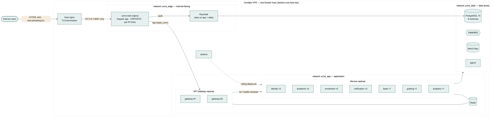
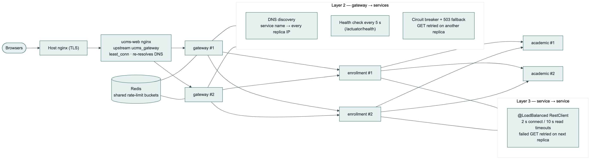
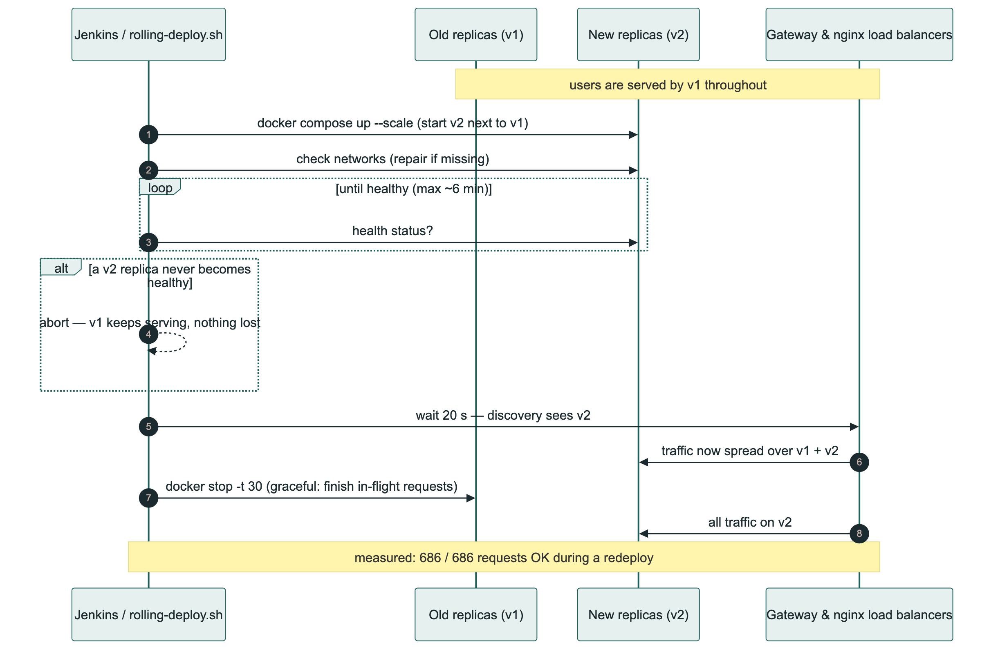

# UCMS V3 — Security, Load Balancing and Rate Limiting Guide

**What this is:** how the security hardening, load balancing and rate limiting in UCMS work,
how to configure and operate them, and how to deploy them to the production server.
**Status:** implemented and tested (commit `e2c2681`, branch `docs/system-audit-phase1`),
**not yet deployed** to production.
**Related:** design rationale in [`../security-loadbalancing-ratelimit-plan.md`](../security-loadbalancing-ratelimit-plan.md);
full change list in [`../implementation-change-log.md`](../implementation-change-log.md) Part 4;
test evidence in [`../test-execution-report.md`](../test-execution-report.md) Part 4.

---

## 1. The big picture

Every request passes through four layers. Each one has a security job, a load-balancing job and a
rate-limiting job:

| Layer | Security | Load balancing | Rate limiting |
|---|---|---|---|
| **Host nginx** (shared, TLS for `esd.azhosting.fun`) | HTTPS termination | — | — |
| **`ucms-web` nginx** (`web/nginx.conf`) | Security headers + CSP, Keycloak admin blocked, body-size limits | Spreads `/api` over every gateway replica | Per client IP |
| **API Gateway** (`services/gateway`) | Verifies every Keycloak token, checks logout revocation | Routes to healthy service replicas, retries, circuit breakers | Per signed-in user (Redis) |
| **Services** | Verify the token again, enforce roles/scopes | Load-balanced service-to-service calls | — |


Source: [`diagrams/14-deployment-architecture.mmd`](diagrams/14-deployment-architecture.mmd)

---

## 2. Security

### 2.1 What a browser can reach

- **Only** `https://esd.azhosting.fun`. The `ucms-web` container listens on `127.0.0.1:8091` —
  the server's own loopback — so the host's HTTPS proxy is the only way in. There is no plain-HTTP
  address any more, and CORS only allows the HTTPS domain.
- Backend services, the gateway, Postgres, Redis, RabbitMQ, MinIO and Keycloak's port publish
  nothing to the public internet. Administrators reach them over an SSH tunnel.

### 2.2 Edge protections (`web/nginx.conf`, `web/nginx/*.conf`)

| Protection | Setting | Why |
|---|---|---|
| HSTS | `max-age=31536000; includeSubDomains` | Browsers never fall back to HTTP |
| Content-Security-Policy | `script-src 'self'`, `frame-ancestors 'self'`, `object-src 'none'` … | An injected script can't run, and the app can't be framed by another site |
| `X-Content-Type-Options: nosniff` | always | A downloaded file is never executed as script/HTML |
| `Referrer-Policy`, `Permissions-Policy`, `Cross-Origin-Opener-Policy` | always | Less leaked information, no camera/mic/location, window isolation |
| `server_tokens off` | — | nginx version not advertised |
| Keycloak admin console, master realm, health, metrics | `return 404` | The identity provider's admin surface is not on the public site |
| Request body size | 1 MB, 25 MB on the two upload endpoints | Large bodies only where a 20 MB submission is legitimate |

Keycloak's own pages keep **Keycloak's** CSP and stricter `Referrer-Policy: no-referrer`; only the two
headers Keycloak doesn't send are added there (`web/nginx/keycloak-headers.conf`).

To keep the app working under a strict CSP: the production build does not inline critical CSS
(that inserted an inline `onload` handler), and `silent-check-sso.html` loads an external
`silent-check-sso.js`. Verified in a real browser: sign-in, silent SSO and fonts work with
**zero CSP violations**.

### 2.3 Identity (Keycloak)

| Setting | Value |
|---|---|
| Password policy | 12–128 characters, not the username, not the email, not one of the last 3 |
| Brute-force protection | on (10 failures, increasing waits) |
| Access-token lifetime | 5 minutes (silently refreshed by the browser) |
| Login + admin events | recorded, kept 30 days |
| Web-client redirect origins | `https://esd.azhosting.fun`, plus `localhost` for development |
| Admin two-factor (OTP) | **built, switched off** — `harden_realm.py --admin-mfa on` |
| Refresh-token rotation | **off on purpose** — it would sign a user out of their other tabs |

The realm file (`infra/keycloak/realm/ucms-realm.json`, generated by `generate-realm.py`) only
applies to a new Keycloak. For an existing one, run `infra/keycloak/harden_realm.py` (§6, step 5).

The UCMS API validates passwords with the same rule (`CreateUserRequest`, `UpdatePasswordRequest`),
and if Keycloak still refuses a password (for example, a recent one), the user gets **400 with
Keycloak's reason**, not a misleading "service unavailable".

### 2.4 Containers

Every Java service container (`infra/docker-compose.deploy.yml`, `x-hardening`):

- runs as an unprivileged user (`ucms`, uid 100), not root
- has a **read-only** filesystem (only `/tmp` is writable, in memory)
- has **all Linux capabilities dropped** and `no-new-privileges`
- is capped at **768 MB / 1 CPU**, with the Java heap sized from that limit
- uses a base image **pinned by digest** (`eclipse-temurin:17.0.20.1_1-jre-alpine@sha256:…`)

The nginx container is read-only with only the four capabilities nginx needs to start.

### 2.5 Network segmentation

| Network | Members | Effect |
|---|---|---|
| `ucms_edge` | web, gateway, Keycloak | the internet-facing container sees only these |
| `ucms_app` | gateway, all services, Keycloak, Redis | application traffic |
| `ucms_data` | services, Keycloak, Postgres, RabbitMQ, MinIO, SMTP | data stores |

Verified: from inside the web container neither Postgres nor any service even resolves; from the
gateway, Postgres doesn't resolve.

### 2.6 Supply chain (Jenkins **Security Scan** stage)

- **Trivy** scans the built jars (every transitive dependency) and, before deploying, the images.
- **npm audit** scans the frontend's production packages.
- Reports are archived on every build. `SECURITY_GATE = 'report'` marks a build UNSTABLE on findings;
  `'fail'` fails it.

> **Open issue — highest priority.** The scan currently finds **14 critical / 64 high** CVEs in the
> backend (Spring Boot 3.3.4 line) and **4 high** in Angular 19. Fix: upgrade to Spring Boot 3.5.x +
> Spring Cloud 2025.0.x and Angular 21, then set `SECURITY_GATE = 'fail'`.
> See [`../remaining-issues.md`](../remaining-issues.md) §5.

---

## 3. Load balancing


Source: [`diagrams/15-load-balancing.mmd`](diagrams/15-load-balancing.mmd)

### 3.1 Replicas

| Service | Default replicas | `.env` override |
|---|---|---|
| gateway | 2 | `GATEWAY_REPLICAS` |
| identity-access | 2 | `IDENTITY_REPLICAS` |
| academic-structure | 2 | `ACADEMIC_REPLICAS` |
| enrollment | 2 | `ENROLLMENT_REPLICAS` |
| notification | 2 | `NOTIFICATION_REPLICAS` |
| base, assignment-grading, analytics | 1 each | `BASE_REPLICAS`, `GRADING_REPLICAS`, `ANALYTICS_REPLICAS` |

Each Java replica may use up to 768 MB — **check `free -m` on the host before raising these**.

### 3.2 How a request finds a replica

1. **nginx → gateway.** An `upstream` with `least_conn` and `resolve`: Docker's DNS answers the name
   `gateway` with every replica, and nginx re-reads it every 10 s.
2. **gateway → service.** Routes use `lb://<service>`. `DnsDiscoveryClient` turns the service name
   into one instance per replica; every instance is health-checked every 5 s and dropped while it
   fails. Each route has a **circuit breaker** (opens after half of 20 calls fail; callers get an
   immediate 503 `SERVICE_UNAVAILABLE` for 10 s) and **retries GET requests** twice on another
   replica. Writes are never retried — a retried POST could enroll a student twice.
3. **service → service.** Every client is built from a `@LoadBalanced RestClient.Builder`
   (`config/ServiceClientConfig`): 2 s connect / 10 s read timeouts (30 s for analytics), one retry of
   a failed GET on the next replica, and the `X-Request-Id` passed along.

### 3.3 What had to change for replicas to be safe

| Problem with more than one copy | Fix |
|---|---|
| Live notifications held in one replica's memory | `LivePushFanout`: every push is broadcast over Redis; each replica delivers to the browsers it holds |
| Scheduled jobs would run on every replica | **ShedLock** (`shedlock` table) — the Keycloak reconciler and report/dashboard jobs run on one replica at a time |
| Fixed `container_name` prevented scaling | removed; services are addressed by Compose service name |
| Database connections | pool of 5 per replica; Postgres `max_connections=200`; Keycloak pool 20 |
| Requests cut off when a replica stops | graceful shutdown (finish in-flight requests, 20 s) + 30 s stop grace |

### 3.4 Zero-downtime deploys — `infra/rolling-deploy.sh`



For each service: start the new replicas **next to** the old ones → check their network attachments
→ wait until healthy → wait 20 s for discovery → stop the old ones gracefully. If a new replica never
becomes healthy, the script stops and **the old version keeps serving**.

```bash
cd /opt/ucms-app/infra
./rolling-deploy.sh                         # everything
./rolling-deploy.sh enrollment-service      # one service
./rolling-deploy.sh --check-networks        # only check/repair network attachments
```

Measured: **686 of 686 requests succeeded** while base-service and the gateway were redeployed.

---

## 4. Rate limiting

### 4.1 Two layers

| Layer | Keyed by | Purpose |
|---|---|---|
| nginx `limit_req` / `limit_conn` | client IP | Cheap flood protection, and protects Keycloak's login and token endpoints |
| Gateway `RateLimitFilter` | signed-in user (else client IP) | Fair per-user quotas, shared by every gateway replica through Redis |

### 4.2 nginx limits (per client IP)

| Endpoint | Limit |
|---|---|
| Keycloak password form (`/auth/realms/ucms/login-actions/…`) | 30 / minute, burst 30 |
| Keycloak token endpoint | 120 / minute, burst 60 |
| `/api/…` | 50 / second, burst 200 |
| Live notification streams | 10 open per IP |

These are generous on purpose: a campus network can put a whole lab behind one IP address. The real
per-account protection for passwords is Keycloak's brute-force lockout.

### 4.3 Gateway limits (per user) — `services/gateway/src/main/resources/application.yml`

| Tier | Requests | Limit |
|---|---|---|
| `live-stream` | the notification stream | not limited |
| `uploads` | POST submissions / briefs | 10 per minute |
| `analytics-writes` | writes under `/api/analytics` | 6 per minute |
| `enrollment-writes` | writes under `/api/enrollment` | 2 per second, burst 10 |
| `user-writes` | writes under `/api/identity/users` | 2 per second, burst 10 |
| `default` | everything else | 20 per second, burst 40 |

The first matching tier wins; each tier has its own bucket per user. Over the limit:

```http
HTTP/1.1 429 Too Many Requests
Retry-After: 1
X-RateLimit-Remaining: 0

{"message":"Too many requests — please wait 1 second and try again.","code":"RATE_LIMITED"}
```

The Angular app shows that message as-is. If Redis is unreachable the check is skipped (logged) — a
cache outage must not take the site down; nginx's per-IP limits still apply.

**Tuning:** change `limit`, `period` and `burst` in the tier, redeploy the gateway. Turn the whole
thing off with `UCMS_RATE_LIMIT_ENABLED=false`.

---

## 5. Tracing a request

Every request gets an `X-Request-Id` (nginx creates it, the gateway passes it on, each service puts it
into every log line and forwards it on service-to-service calls). Given the id from a browser's
response headers or an error report:

```bash
docker logs ucms-web | grep <id>                                   # which gateway served it, timing
docker compose -f docker-compose.deploy.yml logs | grep <id>       # every service it touched
```

---

## 6. Production rollout — in this order

Steps 3 and 4 are one short maintenance window (infrastructure containers restart once).

1. **Host nginx first** — it becomes the only way in. For `esd.azhosting.fun`:
   ```nginx
   proxy_pass http://127.0.0.1:8091;
   proxy_set_header X-Forwarded-For   $proxy_add_x_forwarded_for;
   proxy_set_header X-Forwarded-Proto https;
   proxy_set_header Host              $host;
   client_max_body_size 25m;
   # location /api/notification/notifications/stream:
   proxy_buffering off; proxy_read_timeout 1h; proxy_http_version 1.1; proxy_set_header Connection "";
   ```
2. **Docker Compose ≥ 2.24 recommended** (`docker compose version`). Older versions sometimes attach a
   container to only some of its networks; `rolling-deploy.sh` detects and repairs that.
3. **Infra stack** — copy `infra/docker-compose.infra.yml` and `infra/keycloak/` to `/opt/ucms`, then
   `docker compose --env-file .env up -d --build`. Check Keycloak has all three networks:
   `docker inspect -f '{{range $n,$_ := .NetworkSettings.Networks}}{{$n}} {{end}}' ucms-keycloak`.
4. **Application stack** — Jenkins deploy (`develop`/`release`/`main`) or `./rolling-deploy.sh`.
5. **Keycloak hardening** — on the host:
   `KEYCLOAK_ADMIN_PASSWORD=... python3 infra/keycloak/harden_realm.py --url http://127.0.0.1:8180/auth`
   (add `--admin-mfa on` once every administrator has an authenticator app).
6. **Close the old port** — `ufw delete allow 8091/tcp`.
7. **SSH tunnel** for the API is now `-L 8091:127.0.0.1:8091` (was 8090).

## 7. Verifying it in production

```bash
curl -sI https://esd.azhosting.fun/ | grep -iE 'strict-transport|content-security|x-content-type'
curl -s -o /dev/null -w '%{http_code}\n' https://esd.azhosting.fun/auth/admin/        # 404
curl -s -o /dev/null -w '%{http_code}\n' http://169.58.12.239:8091/                   # connection refused
docker ps --format '{{.Names}} {{.Status}}' | grep -c healthy                          # every replica healthy
cd /opt/ucms-app/infra && ./rolling-deploy.sh --check-networks
```

The automated checks used in testing can be pointed at any environment:
`docs/test-evidence/container_test.py` (edge, load balancing, limits, isolation) and
`docs/test-evidence/csp_browser_test.js` (real browser under the CSP).

## 8. Troubleshooting

| Symptom | Likely cause | Fix |
|---|---|---|
| Every second request is 503 | a gateway replica isn't on `ucms_app` | `./rolling-deploy.sh --check-networks` |
| 503 `SERVICE_UNAVAILABLE` for one area | that service has no healthy replica (circuit open) | `docker ps`, `docker logs <replica>` |
| Users see 429 during normal use | tier too tight, or many users behind one IP without a token | raise the tier / nginx `api_ip` limit |
| "Rate limit check skipped, Redis unavailable" in gateway logs | Redis down or unreachable | check `ucms-redis`; limits fail open meanwhile |
| A new replica never becomes healthy in a deploy | startup failure | the script printed its logs; old replicas still serve |
| Browser console shows CSP violations | a new external resource | add its origin to `web/nginx/app-csp.conf` |
| Password change rejected with Keycloak's message | Keycloak policy (length, email, last 3) | expected — choose another password |
