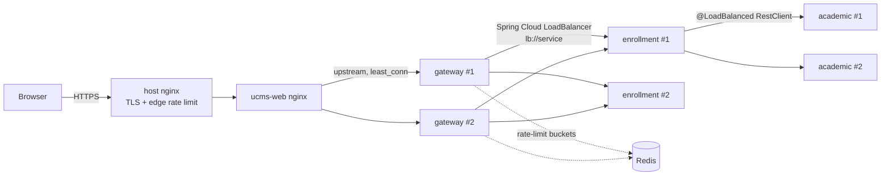

# Security hardening, load balancing and rate limiting — implementation plan

Status: **implemented 2026-10-29** (uncommitted working tree) — what was built, the
production rollout steps and the deliberate departures from this plan are in
[`implementation-change-log.md` Part 4](implementation-change-log.md); test results in
[`test-execution-report.md` Part 4](test-execution-report.md). The "current state" below is
as it was before implementation.

## 1. Where the system stands today

```
Internet ──HTTPS──▶ host nginx (TLS, esd.azhosting.fun)
                        │
                        ▼
                 ucms-web (nginx :80, published 0.0.0.0:8091)
                  ├── /        Angular SPA
                  ├── /auth/   ──▶ ucms-keycloak:8080
                  └── /api/    ──▶ ucms-gateway:8080 (Spring Cloud Gateway, 1 instance)
                                     └──▶ 7 backend services, 1 instance each,
                                          addressed by fixed container name
```

What is already in good shape (keep it):

| Area | Current state |
|---|---|
| Identity | Keycloak issues every token; RS256 + JWKS; PKCE for the browser; per-service `client_credentials` clients with least-privilege `svc:*` roles |
| Defence in depth | Gateway validates every token (`JwtBackstopFilter`), and **each backend validates again** (`JwtAuthFilter`) |
| Network exposure | Backend services publish no ports; gateway is `127.0.0.1:8090`; Postgres/Redis/RabbitMQ/MinIO/Keycloak are all `127.0.0.1`-only |
| Database | One Postgres role per schema — a compromised service can't read another service's tables |
| Actuator | Only `health,info` exposed |
| Logout | Gateway checks a Redis revocation list |
| Brute force | Keycloak `bruteForceProtected: true`, `failureFactor: 10` |
| Downloads | Served with `Content-Disposition: attachment` |

What is missing or weak:

| # | Gap | Where |
|---|---|---|
| S1 | `ucms-web` is published on **all interfaces** (`8091:80`) over plain HTTP, bypassing the host's TLS nginx; CORS even whitelists `http://169.58.12.239:8091` | `infra/docker-compose.deploy.yml` (web `ports`, gateway `CORS_ALLOWED_ORIGIN`) |
| S2 | Keycloak **admin console and master realm are reachable from the internet** via the `/auth/` proxy | `web/nginx.conf` `location ^~ /auth/` |
| S3 | No security headers (CSP, HSTS, `X-Content-Type-Options`, `frame-ancestors`, `Referrer-Policy`); nginx version leaked | `web/nginx.conf` |
| S4 | Containers run as **root**, no `read_only`, `cap_drop`, `no-new-privileges`, or memory/CPU limits | every `Dockerfile`, both compose files |
| S5 | Floating image tags (`eclipse-temurin:17-jre-alpine`, `cgr.dev/chainguard/minio:latest`) | Dockerfiles, `docker-compose.infra.yml` |
| S6 | Password policy is only `length(8)`; no MFA for administrators | `infra/keycloak/generate-realm.py` |
| S7 | All containers share one flat network (`ucms_default`) — Keycloak, MinIO, the web container can all reach every service and the database directly | both compose files |
| S8 | `client_max_body_size 25m` applies to **every** route, not just submissions | `web/nginx.conf` |
| S9 | No dependency/image vulnerability scanning; no central audit of auth events | CI / Keycloak realm |
| L1 | Exactly one instance of everything; a crash or redeploy of any service is an outage for that feature | `docker-compose.deploy.yml` |
| L2 | Every service has a fixed `container_name`, which makes `docker compose --scale` impossible | `docker-compose.deploy.yml` |
| L3 | Gateway routes and service-to-service clients point at a single host URL — no load balancing, retries or circuit breaking | `services/gateway/.../application.yml`, every `client/*Client.java` |
| L4 | State that breaks with >1 instance (details in §3.2) | `LivePushHub`, `@Scheduled` jobs |
| R1 | **No rate limiting anywhere** — not at nginx, not at the gateway | — |

## 2. Security hardening

Ordered by risk reduction per hour of work.

### 2.1 Close the side doors (S1, S2) — do this first

**S1 — stop publishing the web container publicly.** The host nginx is the only thing that
should reach it:

```yaml
# infra/docker-compose.deploy.yml → web
ports:
  - "127.0.0.1:8091:80"
```

and drop `http://169.58.12.239:8091` from the gateway's `CORS_ALLOWED_ORIGIN`. Point the
host nginx's `proxy_pass` at `127.0.0.1:8091` (it almost certainly already is). Also
`ufw default deny incoming; ufw allow 22,80,443/tcp` on the host — note Docker bypasses
ufw for published ports, which is exactly why the `127.0.0.1:` prefix matters.

**S2 — keep the Keycloak admin surface private.** Browsers only need the `ucms` realm.
Add, *before* the general `/auth/` block in `web/nginx.conf`:

```nginx
location ^~ /auth/admin/          { return 404; }
location ^~ /auth/realms/master/  { return 404; }
location ^~ /auth/metrics         { return 404; }
location ^~ /auth/health          { return 404; }
```

Administrators reach the console through the existing SSH tunnel to `127.0.0.1:8180`.

### 2.2 Edge headers and request limits (S3, S8)

In `web/nginx.conf`, at `server` level:

```nginx
server_tokens off;
add_header Strict-Transport-Security "max-age=31536000; includeSubDomains" always;
add_header X-Content-Type-Options "nosniff" always;
add_header Referrer-Policy "strict-origin-when-cross-origin" always;
add_header Permissions-Policy "camera=(), microphone=(), geolocation=()" always;
add_header Content-Security-Policy "default-src 'self'; script-src 'self'; style-src 'self' 'unsafe-inline'; img-src 'self' data:; connect-src 'self'; frame-src 'self'; frame-ancestors 'none'; base-uri 'self'; form-action 'self'" always;

client_max_body_size 1m;                         # default for everything
location ~ ^/api/grading/.*/submissions { client_max_body_size 25m; proxy_pass ...; }
```

Notes:
- `frame-src 'self'` is required because `keycloak-js` uses a same-origin iframe
  (`silent-check-sso.html`). Keycloak's own pages send their own CSP, so the `/auth/`
  location should **not** inherit this one — use `proxy_hide_header`/no `add_header` there.
- nginx `add_header` in a `location` *replaces* server-level headers. The two existing
  `Cache-Control` locations must repeat the security headers (or move them into an
  `include security-headers.conf;` snippet used everywhere).
- Angular's `style-src 'unsafe-inline'` is needed for component styles; tighten later
  with nonces if wanted.

### 2.3 Container hardening (S4, S5)

Each service `Dockerfile`:

```dockerfile
FROM eclipse-temurin:17.0.13_11-jre-alpine@sha256:<digest>
RUN addgroup -S app && adduser -S app -G app
WORKDIR /app
COPY --chown=app:app target/*.jar app.jar
USER app
ENTRYPOINT ["java", "-XX:MaxRAMPercentage=75", "-jar", "app.jar"]
```

A shared anchor in `docker-compose.deploy.yml`, merged into every service:

```yaml
x-hardening: &hardening
  read_only: true
  tmpfs: [/tmp]
  security_opt: ["no-new-privileges:true"]
  cap_drop: [ALL]
  deploy:
    resources:
      limits: { memory: 768m, cpus: "1.0" }
```

(`ucms-web`'s nginx needs `cap_add: [NET_BIND_SERVICE]` or move it to port 8080
internally; and writable `tmpfs` for `/var/cache/nginx` and `/var/run`.) Pin MinIO and
every other image to a version + digest; let Dependabot/Renovate bump them.

### 2.4 Network segmentation (S7)

Split the one flat network into three:

| Network | Members |
|---|---|
| `edge` | web, gateway, keycloak |
| `app` | gateway, 7 services, keycloak (services fetch JWKS / client tokens) |
| `data` | 7 services, keycloak, postgres, redis, rabbitmq, minio |

Result: the web container (the internet-facing one) can no longer open a socket to
Postgres or to a backend service directly; MinIO can't call services. This is a compose
change only — no code.

### 2.5 Identity hardening (S6)

In `infra/keycloak/generate-realm.py`:

```python
"passwordPolicy": "length(12) and notUsername and notEmail and passwordHistory(3) and maxLength(128)",
"revokeRefreshToken": True,          # refresh-token rotation: a stolen refresh token is single-use
"refreshTokenMaxReuse": 0,
"eventsEnabled": True,               # LOGIN / LOGIN_ERROR / LOGOUT events
"adminEventsEnabled": True,
"eventsExpiration": 2592000,         # 30 days
```

- **MFA for administrators:** a conditional authentication flow — "Condition – user role
  `ADMIN`" → "OTP Form". Lecturers/students unaffected. Add it to the realm JSON so it's
  reproducible.
- **Existing realm:** `--import-realm` uses `IGNORE_EXISTING`, so these don't reach an
  already-imported realm. Apply them once with `kcadm.sh update realms/ucms -s ...` (and
  record that in `docs/implementation-change-log.md`), the same way the manual schema step
  is handled.
- Rotate the seven `KC_SVC_*_SECRET` values and `KEYCLOAK_ADMIN_PASSWORD` on a schedule;
  they live only in the host `.env`, which should be `chmod 600`, owned by root.

### 2.6 Application-level items

- **Uploads (assignment-grading-service):** today the stored `Content-Type` comes from the
  client. Keep `attachment` (already done), add `X-Content-Type-Options: nosniff` on the
  download response, and enforce an extension/MIME allow-list (pdf, docx, zip, txt, …) in
  `SubmissionService` before writing to MinIO. Optional: ClamAV sidecar scan.
- **CSRF stays disabled** — correct, because auth is a bearer header, not a cookie. Keep it
  that way: never move the access token into a cookie without re-enabling CSRF.
- **Gateway revocation check fails open when Redis is down** (documented trade-off). With
  5-minute access tokens and refresh rotation the exposure is small; keep, but alert on it.
- **Correlation IDs:** add a gateway `GlobalFilter` that sets `X-Request-Id` if absent and a
  servlet filter in each service that puts it into the SLF4J MDC — needed to trace
  rate-limit and auth incidents across services.

### 2.7 Supply chain and monitoring (S9)

- CI: `mvn org.owasp:dependency-check-maven:check -DfailBuildOnCVSS=8`, `npm audit
  --audit-level=high`, and `trivy image` on every built image.
- OWASP ZAP baseline scan against a staging deploy (unauthenticated + authenticated).
- Host: `fail2ban` jail on the host nginx log for repeated 401/429 from one IP.

## 3. Load balancing

### 3.1 Be clear about what it buys on one server

Everything runs on one Contabo host. Multiple replicas there give **zero-downtime
deploys, survival of a single JVM crash/OOM, and use of more CPU cores** — they do **not**
survive the host going down. Surviving that needs a second host (Docker Swarm or k8s) and
a highly available Postgres; out of scope here, but the changes below are all
prerequisites for it and nothing here would need redoing.

### 3.2 Fix what breaks with more than one instance (prerequisite)

| Blocker | Why it breaks | Fix |
|---|---|---|
| `container_name:` on every service (L2) | Compose can't create a second container with the same name | Remove `container_name`; address services by **service name** (`identity-access-service`), which Docker DNS resolves to all replicas. Update every `*_URI` env var accordingly |
| `LivePushHub` keeps SSE connections in an in-memory map (`notification-service/.../LivePushHub.java:31`) | A notification produced on instance A never reaches a user whose SSE stream is held by instance B | After persisting a notification, `PUBLISH ucms:push <userId,payload>` on Redis; every instance `SUBSCRIBE`s and pushes to whichever emitters it holds locally. (Alternative: a per-instance exclusive RabbitMQ queue bound to a fanout exchange.) |
| `KeycloakReconciler` `@Scheduled` (identity) | Two instances race to create the same Keycloak user → duplicate-user conflicts | **ShedLock** (`shedlock-spring` + `shedlock-provider-jdbc-template`), one `shedlock` table per schema via a new Flyway migration; annotate `@SchedulerLock(name="keycloak-reconcile", lockAtMostFor="55s")` |
| `SnapshotService` / `ScheduleService` `@Scheduled` (analytics) | Scheduled reports/snapshots generated N times | Same ShedLock treatment |
| `RoleCatalogClient` cache, `LivePushHub` heartbeat, `ClientCredentialsTokenProvider` cache | Per-instance by nature | No change needed |
| RabbitMQ listeners | Become competing consumers — each message processed once, by one instance | Fine, but confirm each handler is idempotent (redelivery after a crash already requires it) |
| Flyway on startup | Two replicas migrating at once | Safe: Flyway takes a Postgres advisory lock |
| DB connections | 8 services × Hikari default 10 = 80, + Keycloak; Postgres default `max_connections=100`. Two replicas each blows it | Set `spring.datasource.hikari.maximum-pool-size: 5` per instance and raise Postgres `max_connections` to 200 (or add PgBouncer in transaction mode) |

### 3.3 Three layers of balancing



**Layer 1 — nginx → gateway replicas** (`web/nginx.conf`):

```nginx
upstream ucms_gateway {
    least_conn;
    server gateway:8080 resolve max_fails=3 fail_timeout=10s;   # nginx ≥1.27.3 re-resolves DNS
    keepalive 32;
}
resolver 127.0.0.11 valid=10s;   # Docker's embedded DNS
```

and `proxy_pass http://ucms_gateway/api/;` in both `/api/` locations. The SSE location
needs no stickiness — any gateway can proxy a stream; the Redis fan-out from §3.2 makes
any notification instance able to deliver.

**Layer 2 — gateway → services.** Add `spring-cloud-starter-loadbalancer` to
`services/gateway/pom.xml` and change each route `uri` to `lb://<service>`, with a static
instance list (no Eureka/Consul needed on one host):

```yaml
spring:
  cloud:
    discovery:
      client:
        simple:
          instances:
            enrollment-service:
              - uri: http://ucms-infra-enrollment-service-1:8085
              - uri: http://ucms-infra-enrollment-service-2:8085
    loadbalancer:
      health-check: { interval: 5s, path: { default: /actuator/health } }
      configurations: health-check        # skip instances whose /actuator/health is down
```

Plus per-route resilience:

```yaml
filters:
  - StripPrefix=2
  - name: Retry
    args: { retries: 2, methods: GET, series: SERVER_ERROR, exceptions: java.io.IOException }
  - name: CircuitBreaker
    args: { name: enrollment, fallbackUri: forward:/fallback/unavailable }
```

(`spring-cloud-starter-circuitbreaker-reactor-resilience4j`; retries only on GET —
retrying a POST could double-enroll a student). Set
`spring.cloud.gateway.httpclient.connect-timeout: 2000` and `response-timeout: 15s`
(the SSE route overrides it with `metadata.response-timeout: -1`).

> Simpler alternative if a static list feels heavy: leave routes as
> `http://enrollment-service:8085` and rely on Docker DNS round-robin. It works, but the
> JVM and Reactor Netty cache resolved addresses and pooled connections, so traffic
> sticks to one replica and a dead one isn't skipped. The LoadBalancer + health-check
> approach is worth the extra YAML.

**Layer 3 — service → service.** The client classes already take an injected
`RestClient.Builder` (e.g. `enrollment-service/.../client/AcademicClient.java`), so the
change is one bean per service:

```java
@Bean @LoadBalanced
RestClient.Builder loadBalancedRestClientBuilder() { return RestClient.builder(); }
```

and `*_SERVICE_URI` values become `http://academic-structure-service` (logical name,
resolved by the same `simple` discovery list). Add Resilience4j `@CircuitBreaker` +
`@Retry` (GET only) around the `Upstream` helpers that already map failures to 503, and
set connect/read timeouts on the builder (today there are none, so a hung dependency
holds a request thread indefinitely). `AssignmentCache`/`RoleCatalogClient` in
academic-structure and `AcademicStructureClient` in base build their own `RestClient` —
switch them to the injected load-balanced builder too.

### 3.4 Replica counts and deploys

```yaml
gateway:                    { deploy: { replicas: 2 } }
identity-access-service:    { deploy: { replicas: 2 } }
academic-structure-service: { deploy: { replicas: 2 } }
enrollment-service:         { deploy: { replicas: 2 } }   # takes the enrollment-window spike
notification-service:       { deploy: { replicas: 2 } }   # holds long-lived SSE connections
base / grading / analytics: { deploy: { replicas: 1 } }   # raise when metrics say so
```

Zero-downtime redeploy becomes a rolling script: rebuild, then for each replica `stop` →
`up --no-deps` → wait for healthy → next. Keycloak stays single-instance for now
(clustering needs `KC_CACHE=ispn` + JDBC-ping discovery); it's off the request hot path —
services only call it for JWKS (cached) and client tokens (cached).

## 4. Rate limiting

### 4.1 Two layers, different jobs

| Layer | Keyed by | Purpose |
|---|---|---|
| **nginx** (`limit_req`) | client IP | Cheap, coarse flood protection *before* a JVM or Keycloak does any work; protects Keycloak's login/token endpoints, which never pass through the gateway |
| **Gateway** (`RequestRateLimiter` + Redis) | authenticated user id (token `uid`), else IP | Fair per-user quotas, shared across gateway replicas through Redis (already a gateway dependency) |

Service-to-service calls don't go through either — they're trusted, authenticated with
client tokens, and protected by the circuit breakers/bulkheads from §3.3 instead.

### 4.2 Getting the real client IP

Requests arrive host nginx → web nginx → gateway, so `$remote_addr` at the web container is
the host nginx. Without fixing this, every user shares one bucket. In `web/nginx.conf`:

```nginx
set_real_ip_from 172.16.0.0/12;     # docker bridge range the host nginx connects from
set_real_ip_from 127.0.0.1;
real_ip_header   X-Forwarded-For;
real_ip_recursive on;
```

and make sure the host nginx sends `X-Forwarded-For $proxy_add_x_forwarded_for`. The
gateway's key resolver then reads the **first** `X-Forwarded-For` entry that the web
nginx sets (it overwrites, so a client can't spoof it), never the raw header from the
internet.

### 4.3 nginx edge limits (`web/nginx.conf`, `http` context)

```nginx
limit_req_zone $binary_remote_addr zone=kc_login:10m rate=10r/m;
limit_req_zone $binary_remote_addr zone=kc_token:10m rate=60r/m;
limit_req_zone $binary_remote_addr zone=api_ip:20m   rate=30r/s;
limit_conn_zone $binary_remote_addr zone=sse_conn:10m;
limit_req_status  429;
limit_conn_status 429;

location ~ ^/auth/realms/ucms/login-actions/authenticate { limit_req zone=kc_login burst=5 nodelay; ... }
location ~ ^/auth/realms/ucms/protocol/openid-connect/token { limit_req zone=kc_token burst=20 nodelay; ... }
location /api/ { limit_req zone=api_ip burst=60 nodelay; ... }
location /api/notification/notifications/stream { limit_conn sse_conn 5; ... }   # tabs per IP
```

Campus caveat: a whole lab or campus NAT can share one public IP. Keep the per-IP API
limit generous (it's a flood guard, not a fairness tool) and do fairness per user at the
gateway. Keycloak's own brute-force lockout remains the per-account login defence.

### 4.4 Gateway per-user limits

Dependency: `spring-boot-starter-data-redis-reactive` (already present). Key resolver:

```java
@Bean
KeyResolver userOrIpKeyResolver() {
    return exchange -> exchange.getPrincipal()                  // set by JwtBackstopFilter if added
        .map(p -> "u:" + p.getName())
        .switchIfEmpty(Mono.fromSupplier(() -> "ip:" + clientIp(exchange)));
}
```

`JwtBackstopFilter` already decodes the token; have it stash the `uid` claim as an
exchange attribute (`exchange.getAttributes().put("ucms.uid", uid)`) and read that in the
resolver — no second decode. It must run before the rate-limiter filter (give it a lower
`getOrder()`).

Tiered limits per route group (`replenishRate` = steady req/s, `burstCapacity` = bucket):

| Route group | Limit | Why |
|---|---|---|
| Default (all `/api/**`) | 20 r/s, burst 40 per user | Normal UI use is far below this |
| `POST /api/enrollment/**` | 2 r/s, burst 5 per user | Enrollment opening is the real traffic spike; this stops scripted retry-hammering without blocking a real student |
| `POST /api/grading/**/submissions` | 10 per minute per user | Uploads are up to 20 MB each |
| `POST /api/analytics/reports**` | 5 per minute per user | Report generation is the most expensive query path |
| `/api/identity/users` writes | 1 r/s per user | Each one also calls Keycloak's admin API |
| SSE stream | excluded from the request limiter | One long request; capped by `limit_conn` at nginx |

```yaml
- id: enrollment-writes
  uri: lb://enrollment-service
  predicates: [ Path=/api/enrollment/**, Method=POST ]
  filters:
    - StripPrefix=2
    - name: RequestRateLimiter
      args:
        key-resolver: "#{@userOrIpKeyResolver}"
        redis-rate-limiter.replenishRate: 2
        redis-rate-limiter.burstCapacity: 5
        redis-rate-limiter.requestedTokens: 1
```

(Route order matters — specific write routes go above the general route for the same
prefix.) For "per minute" limits use `replenishRate: 1, requestedTokens: 6,
burstCapacity: 60` style arithmetic, or Bucket4j if exact per-minute windows are
required.

Behaviour details to decide and document:
- **Redis outage:** Spring's `RedisRateLimiter` **fails open** (allows the request). Same
  stance as the revocation check; nginx's per-IP limit still applies. Alert on it.
- **Response:** 429 with `Retry-After` and the `X-RateLimit-Remaining` headers the filter
  already adds; the body should match the system's existing error JSON shape (custom
  `ServerAccessDeniedHandler`-style handler or a small `WebFilter`).
- **Exemptions:** none for ADMIN by default — an admin account is the most valuable one
  to stop a compromised script on.

### 4.5 Frontend

`web/src/app/core/interceptors/auth.interceptor.ts` (or a new small interceptor): on 429,
show "Too many requests — try again in N seconds" using `Retry-After`, and **don't**
auto-retry. Disable the enroll/submit buttons while a request is in flight so double
clicks don't burn the bucket.

## 5. Rollout order

Each phase is independently deployable and testable; nothing is committed or pushed
without confirmation.

| Phase | Contents | Effort | Risk |
|---|---|---|---|
| 1. Quick wins | S1, S2, S3, S8, `server_tokens off`, ufw | ½ day | Low — config only. Check the SPA + Keycloak login still work under the CSP |
| 2. Edge rate limits | real-IP config, nginx `limit_req`/`limit_conn` | ½ day | Low |
| 3. Identity hardening | password policy, refresh rotation, events, admin MFA (realm JSON + one-time `kcadm`) | ½ day | Medium — existing users keep their passwords; the new policy applies at next change |
| 4. Gateway rate limits | key resolver, tiered `RequestRateLimiter` routes, 429 body, frontend handling | 1–1½ days | Medium |
| 5. Scale-readiness | remove `container_name`, Redis fan-out for SSE, ShedLock + migrations, Hikari sizing, timeouts | 2 days | Medium — `LivePushHub` change needs its own test |
| 6. Load balancing | nginx upstream, gateway `lb://` + health checks + retry/circuit breaker, `@LoadBalanced` clients, replicas, rolling deploy script | 2 days | Medium |
| 7. Containers & network | non-root images, `x-hardening`, pinned digests, three networks | 1 day | Low–medium (read-only FS can surface hidden writes) |
| 8. Supply chain | dependency-check, npm audit, Trivy, ZAP in CI | 1 day | Low |

## 6. How each part gets verified

| What | Test |
|---|---|
| S1/S2 | From outside the host: `curl http://<ip>:8091` → refused; `curl https://esd.azhosting.fun/auth/admin/` → 404; the app login still works |
| Headers | `curl -I https://esd.azhosting.fun/` shows HSTS/CSP/nosniff; browser console shows no CSP violations through a full login → enroll → submit flow (Playwright `ui_test.js`) |
| nginx limits | Burst 30 wrong logins from one IP → 429 after the burst; Keycloak lockout still triggers per account |
| Gateway limits | New gateway tests with an embedded Redis (Testcontainers): N+1th request in the window → 429 with `Retry-After`; two different users don't share a bucket; unauthenticated requests fall back to IP |
| Load | k6 (or `postman performance run` against the existing collection) simulating 300 students opening enrollment at once: p95 latency, zero 5xx, 429s only for scripted clients |
| Failover | With 2 replicas, `docker kill` one enrollment instance mid-load → GETs keep succeeding (retry + health check), no requests hang past the timeout |
| SSE across replicas | User connected to notification #1; event consumed by notification #2 → still pushed (new integration test for the Redis fan-out) |
| Scheduled jobs | 2 identity replicas → reconciler runs once per minute (ShedLock row), no duplicate Keycloak users |
| Regression | All unit suites (225 tests), `system_test.py`, `ui_test.js` after every phase |

## 7. Open decisions

1. **Edge limits on host nginx or web nginx?** Recommended: web nginx (versioned in this
   repo). Host nginx is shared with other sites and not in source control.
2. **Second host?** Only if real high availability (host failure) is a requirement; then
   Swarm (closest to the current compose files) plus Postgres replication.
3. **Exact numbers in §4.4** are starting points — tune them after one enrollment window
   with the 429 counts and gateway metrics in hand.
4. **Admin MFA** — confirm admins can use an authenticator app before enforcing it.
